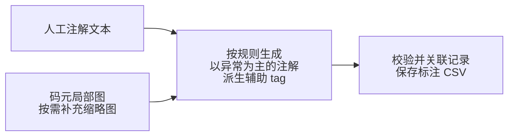
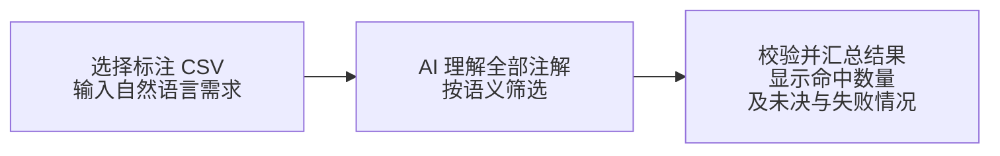
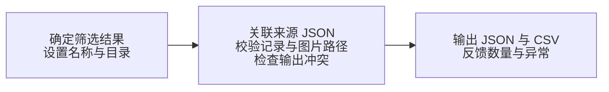
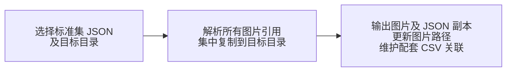
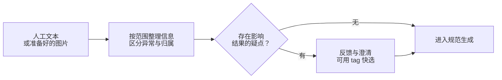

# 图片注解、AI 语义筛选与标准集生成设计说明

更新日期：2026-10-22
状态：功能与数据组织设计；尚未实现。以异常注解为核心，由 AI 执行语义筛选，tag 用于辅助交互。详细 CSV 协议、注解与筛选规则、参考示例及目标模型待补充。

**当前阶段实施范围：**仅推进注解生成本身相关的工作，包括人工描述规范化、注解与图片记录关联、CSV 保存及相应的操作体验。本文的筛选与组集内容仅作为后期规划；除非用户明确提出开始处理，否则不推进这两项的设计或实现。引用本文的注解规则不表示同时启动筛选或组集工作。

## 目录

- [1. 设计概述](#1-设计概述)
  - [1.1 阅读前提与数据对象](#11-阅读前提与数据对象)
  - [1.2 处理粒度与使用边界](#12-处理粒度与使用边界)
  - [1.3 注解、筛选与组集主流程](#13-注解筛选与组集主流程)
  - [1.4 独立的图片集中拷贝流程](#14-独立的图片集中拷贝流程)
- [2. 现有基础与能力边界](#2-现有基础与能力边界)
  - [2.1 数据结构](#21-数据结构)
  - [2.2 能力边界](#22-能力边界)
- [3. 数据组织与关联规则](#3-数据组织与关联规则)
  - [3.1 文件布局](#31-文件布局)
  - [3.2 各类数据的职责](#32-各类数据的职责)
  - [3.3 记录粒度与关联关系](#33-记录粒度与关联关系)
- [4. 注解生成与辅助标签](#4-注解生成与辅助标签)
  - [4.1 分析与输出要求](#41-分析与输出要求)
  - [4.2 图片输入方式](#42-图片输入方式)
  - [4.3 图片处理原则](#43-图片处理原则)
  - [4.4 固定工作流与规范输出](#44-固定工作流与规范输出)
    - [4.4.1 输入方式与信息边界](#441-输入方式与信息边界)
    - [4.4.2 共用处理步骤](#442-共用处理步骤)
    - [4.4.3 分析范围与描述配置](#443-分析范围与描述配置)
    - [4.4.4 缺省正常约定](#444-缺省正常约定)
    - [4.4.5 严重程度规则](#445-严重程度规则)
    - [4.4.6 最终输出与校验要求](#446-最终输出与校验要求)
  - [4.5 分析疑点与用户确认](#45-分析疑点与用户确认)
  - [4.6 规则、示例与辅助标签的持续完善](#46-规则示例与辅助标签的持续完善)
  - [4.7 结果关联与 CSV 保存](#47-结果关联与-csv-保存)
- [5. 标注 CSV 查看与 AI 语义筛选](#5-标注-csv-查看与-ai-语义筛选)
  - [5.1 用户流程](#51-用户流程)
  - [5.2 筛选判断与结果规则](#52-筛选判断与结果规则)
  - [5.3 语义筛选示例](#53-语义筛选示例)
- [6. 新标准集生成](#6-新标准集生成)
  - [6.1 命名与输出目录](#61-命名与输出目录)
  - [6.2 标准信息保留规则](#62-标准信息保留规则)
  - [6.3 生成前校验](#63-生成前校验)
  - [6.4 文件输出与图片路径](#64-文件输出与图片路径)
  - [6.5 来源追溯](#65-来源追溯)
  - [6.6 完成条件与结果反馈](#66-完成条件与结果反馈)
- [7. 图片集中拷贝](#7-图片集中拷贝)
  - [7.1 输入与适用范围](#71-输入与适用范围)
  - [7.2 拷贝步骤](#72-拷贝步骤)
  - [7.3 冲突处理与结果反馈](#73-冲突处理与结果反馈)
- [8. 程序职责与实施顺序](#8-程序职责与实施顺序)
  - [8.1 程序与 Skill 的职责边界](#81-程序与-skill-的职责边界)
  - [8.2 实施顺序](#82-实施顺序)
- [9. 功能验收要点](#9-功能验收要点)
  - [9.1 数据关联与保存](#91-数据关联与保存)
  - [9.2 注解生成与辅助标签](#92-注解生成与辅助标签)
  - [9.3 AI 语义筛选](#93-ai-语义筛选)
  - [9.4 新标准集生成](#94-新标准集生成)
  - [9.5 图片集中拷贝](#95-图片集中拷贝)
- [10. 待细化事项](#10-待细化事项)
  - [10.1 数据组织与关联协议](#101-数据组织与关联协议)
  - [10.2 注解规则、模型与评估](#102-注解规则模型与评估)
  - [10.3 筛选与标准集生成](#103-筛选与标准集生成)
  - [10.4 图片集中拷贝](#104-图片集中拷贝)
- [附录 A. 注解与筛选质量及 Token 评估](#附录-a-注解与筛选质量及-token-评估)
  - [A.1 统计单位与消耗口径](#a1-统计单位与消耗口径)
  - [A.2 质量与规模评估](#a2-质量与规模评估)

## 1. 设计概述

在现有 QuadTool 标准集标注能力上，为已有图片记录补充正确、充分且以异常为主的规范注解。用户以自然语言描述测试需求，由 AI 理解所选图集的全部注解并筛选样本，再由程序生成保留完整标准答案和来源的新标准集。同时提供独立的图片集中拷贝功能，便于整理或交付任意指定标准集。

**注解是内容理解与筛选的主要依据，tag 是从注解派生的辅助信息。** tag 主要用于反馈时快速选择、提示和提供线索，不承担精确匹配的筛选职责，也不限制注解可以表达的内容。Skill 或等效规则文件同时规范注解生成和语义筛选，并通过实际使用中的反馈持续完善规则与正反例。

**注解主要描述异常；在既定分析范围内，未提及异常即默认按正常处理。** 明确表达的不确定性、范围外的属性，以及未处理或失败的记录分别处理，不能被当作正常。具体约定见 [4.4.4](#444-缺省正常约定) 和[第 5 节](#5-标注-csv-查看与-ai-语义筛选)。

### 1.1 阅读前提与数据对象

| 概念            | 本文含义                                                                                                                                                         |
| --------------- | ---------------------------------------------------------------------------------------------------------------------------------------------------------------- |
| 原始图集        | 一份已有标准集 JSON，以及其中引用的图片。JSON 保存图片路径、目标位置和标准答案；图片可以分散存放。“原始”表示它是本次处理的来源，不表示图片必须集中在一个文件夹。 |
| 图片记录与目标  | JSON 中的一条图片记录引用一张图片，其中可以包含多个条码或其他目标，各目标具有自己的位置及标准信息。                                                              |
| 标注 CSV        | 每个图集对应一个标注 CSV，保存图片记录的综合注解、辅助 tag、处理状态及关联信息。它是标准集 JSON 的配套文件，不重复维护整份标准答案，也不同于已有的 Quad 标注。   |
| 注解与 tag      | 注解完整表达异常及其归属，是 AI 筛选的主要依据；tag 从注解派生，用于快捷选择、提示和线索，可以为空。                                                             |
| Skill／规则文件 | 定义注解和筛选的处理步骤、分析范围、输出规则及示例；注解工作流见 [4.4](#44-固定工作流与规范输出)，筛选见[第 5 节](#5-标注-csv-查看与-ai-语义筛选)。              |
| AI 语义筛选     | 依据用户自然语言需求和既定规则，理解选定范围内的全部注解，返回可关联到原始图片记录的筛选结果。                                                                   |
| 生成集          | 从来源图集中筛选得到的新标准集 JSON 及其标注 CSV。保存到另一目录，默认继续引用原图片，并保留记录来源。                                                           |

### 1.2 处理粒度与使用边界

- **一个图集对应一个标注 CSV，一条图片记录对应一行。** 多码图片仍生成一条综合注解，可派生多个辅助 tag；筛选命中后，默认保留该图片记录及全部目标的标准信息。
- **同一图片不一定是同一条标准记录。** 同一图片出现在不同图集中时，标准答案可能不同，不能只按图片路径合并；同一记录符合多个筛选条件时只计一次。
- **文件发现与记录关联分开。** 配套命名用于找到文件，稳定的记录关联用于匹配 CSV 行与 JSON 记录，不能仅依赖文件名、行号或图片序号。
- **各功能可以独立使用。** 已有标注 CSV 可直接查看，也可调用 AI 进行语义筛选，无须重新分析图片或生成注解；对确定结果的组集及独立图片拷贝由程序完成。仅人工文本规范化不要求读取图片。
- **来源数据与生成数据分开保存。** 组集不修改来源 JSON 或 CSV；生成集名称概括筛选主题，允许修改并加前后缀，不承担完整条件表达或来源追溯职责。
- 数据组织兼容现有 DBR、DDN、DLR 结构；AI 注解首期覆盖哪些产品类型仍待确定。本文为功能设计，具体 CSV 协议、规则与示例及交互细节仍需补充。

### 1.3 注解、筛选与组集主流程

主流程分为三个相接的阶段，下图分别从左向右阅读。已有标注 CSV 可直接进入第二阶段。注解工作流在 [4.4](#44-固定工作流与规范输出) 展开。

**① 生成并保存注解。** 人工文本或准备好的图片进入同一规范流程，注解通过校验后关联保存；辅助 tag 可以为空。



**② 查看或语义筛选注解。** CSV 可以自行打开查看；需要筛选时确定文件范围并输入自然语言需求，由 AI 判断，再汇总结果。



**③ 根据筛选结果生成新标准集。** 用户设置主题名称和独立输出目录，程序关联标准答案并校验输出条件。



记录关联使用原始图集的信息，保证每份 CSV 只保存其所属图集的注解。筛选依据 CSV 中的完整注解、处理状态及规则适用范围，tag 仅作辅助；生成时再读取来源 JSON 中的完整图片记录，保留来源并引用原图片。手动查看 CSV 不自动触发组集。

图片入口由程序按原始 location 预先裁剪，交给 Skill 的是码元局部图，必要时额外提供全图缩略图。location 用于程序侧裁剪与记录关联，不作为 Skill 图片入口的必需输入；具体输入边界见 [4.2](#42-图片输入方式)。

目录扫描是发现候选 CSV 的辅助入口，用户仍需确定参与筛选的文件范围。筛选后显示命中数量，生成前校验并列明异常，生成后反馈输出位置、实际数量及异常处理结果；按产品类型分别输出。具体规则见第 [5](#5-标注-csv-查看与-ai-语义筛选)、[6](#6-新标准集生成) 节。

### 1.4 独立的图片集中拷贝流程

原始图集或新生成的图集都可以独立使用此功能，无须先完成主流程。按所选 JSON 的图片引用查找文件，而不是复制其所在文件夹中的全部图片。



默认保留输入 JSON、标注 CSV 和原图片。输出副本供集中存放或交付使用；图片缺失、文件重名及失败处理见 [7.3](#73-冲突处理与结果反馈)。

## 2. 现有基础与能力边界

### 2.1 数据结构

现有标准集以 JSON 保存，统一根节点为 `Picture` 数组：

```text
标准集 JSON
└─ Picture：图片记录列表
   ├─ No.：图片序号
   ├─ Image Source：图片路径
   ├─ 目标数量
   └─ 目标列表：一张图片可以包含多个目标
      ├─ location：四边形位置
      └─ 码型、文本等产品相关信息
```

| 产品类型 | 目标列表             | location 字段                   | 数量字段                       | 其他已有信息                                  |
| -------- | -------------------- | ------------------------------- | ------------------------------ | --------------------------------------------- |
| DBR      | `Barcode Info`       | `Barcode Location`              | `Barcode Count`                | `Barcode Type`、`Barcode Text`、`Barcode Hex` |
| DDN      | `Quadrilateral Info` | `Expected Quadrilateral Points` | `Expected Quadrilateral Count` | 四边形位置                                    |
| DLR      | `Label Info`         | `Label Location`                | `Label Count`                  | `Label Text`、`Label Hex`                     |

location 的现有格式已经明确：原图坐标系中的四个顶点，以八个整数保存为字符串，例如 `x1 y1 x2 y2 x3 y3 x4 y4`。它不是显示缩放后的画布坐标。

`Image Source` 支持绝对路径，也支持相对于所属 JSON 文件的路径。`No.` 在数据规范化时可能重新编号，不能单独作为 CSV 与图片记录的长期关联标识。

### 2.2 能力边界

现有程序可以打开单个标准集、切换同目录中的相邻 JSON、浏览图片以及编辑和保存 Quad。现有实现尚不支持配套 CSV、跨图集注解组织、AI 语义筛选或根据筛选结果生成新标准集。

现有程序以本地离线使用为边界。新增的文件管理、记录组织和组集继续在本地完成；注解生成与语义筛选需要 AI 推理，采用本地模型还是远程 API 待选型，需在实施时同步说明实际运行条件。不能将语义筛选视为无需模型的纯本地标签匹配。

## 3. 数据组织与关联规则

### 3.1 文件布局

原标准集 JSON 与配套 CSV 放在同一目录，采用对应文件名，例如 `A.json` 与 `A.annotations.csv`：

```text
原始标准集目录/
├─ 场景A/
│  ├─ A.json
│  └─ A.annotations.csv
└─ 场景B/
   ├─ B.json
   └─ B.annotations.csv

生成的标准集目录/
├─ 运动模糊_低对比度.json
└─ 运动模糊_低对比度.annotations.csv
```

图片继续保留在原有位置，由各 JSON 中的 `Image Source` 引用。用户可直接选择指定标注 CSV，也可通过扫描原始标准集目录发现候选文件。生成结果保存到独立目录，默认发现范围不纳入生成目录，避免无意重复收录派生结果；用户仍可明确选择生成集的 CSV 参与后续筛选。

### 3.2 各类数据的职责

| 数据               | 保存内容与职责                                                                     |
| ------------------ | ---------------------------------------------------------------------------------- |
| 标准集 JSON        | 图片记录及其完整标准信息，包括目标位置、码型、文本和已有扩展字段                   |
| 配套 CSV           | 以异常为主的综合注解、辅助标签、处理状态、适用规则信息，以及关联和追溯信息         |
| 记录索引           | 从选定 CSV 汇总形成的跨标准集记录映射与注解数据，可以重新生成；不承担精确 tag 匹配 |
| 新标准集 JSON＋CSV | 筛选得到的完整标准记录及对应注解、辅助标签、状态和来源                             |

CSV 不承担复制整份标准答案的职责。生成标准集时，程序根据命中记录的关联读取所属 JSON，取得完整 `Picture` 记录，避免在 JSON 与 CSV 中分别维护两份 Quad、文本等标准信息。

首版可在程序中建立可重建的记录索引，不要求额外数据库或向量检索系统。后续如增加缓存，JSON 和 CSV 仍是持久数据来源，缓存不能覆盖已经更新的注解或规则。

### 3.3 记录粒度与关联关系

一行 CSV 对应**某个标准集中的一条图片记录**。一张图片即使包含多个码区，也仍是一行；同一图片出现在不同标准集中时，分别保留其记录，因为标准答案可能不同。

每条 CSV 记录在逻辑上需要表达：

| 信息                 | 用途                                                             |
| -------------------- | ---------------------------------------------------------------- |
| 所属标准集及图片路径 | 定位当前配套 JSON 中的具体 `Picture` 记录；图片路径即记录关联键  |
| 图片来源             | 显示和校验图片关联，辅助定位文件                                 |
| 综合注解             | 保存异常、问题归属、程度和明确的不确定性，作为语义筛选的主要依据 |
| 辅助标签             | 从注解派生，用于快捷选择、提示和线索；允许为空                   |
| 注解处理状态         | 区分已完成、未处理或失败；已完成且无异常时允许注解正文为空       |
| 适用规则与分析范围   | 识别缺省正常约定的适用范围，以及规则调整后是否需要补充旧注解     |
| 来源追溯信息         | 对于生成集，记录其来源标准集和来源图片记录                       |

配套文件名用于发现文件，记录关联用于精确匹配。前提是同一标准集内图片路径唯一，因此以图片路径（相对路径按所属 JSON 目录解析，Windows 上不区分大小写）作为记录关联键，不另设记录 ID；不能依赖图片文件名、CSV 行号、`No.` 或数组下标，重新排序不影响关联。该前提由程序校验：标准集出现解析后相同的图片路径时停止注解读写并报告；CSV 中出现当前标准集找不到的图片路径时也停止读写，不静默删除。

本节确定关联关系，不固定 CSV 列名、标识生成方式、处理状态及规则引用的存储方式和多值标签编码，这些在实现协议中细化。分析范围可由适用规则引用表达，无须为每个正常项重复增加文本。不能唯一匹配的记录应列为异常，避免猜测关联后导出错误的标准答案。

## 4. 注解生成与辅助标签

本章说明人工文本与图片两种入口如何生成以异常为主的规范注解、派生辅助 tag，并关联记录保存。注解完整性优先于标签覆盖率；质量和消耗评估见[附录 A](#附录-a-注解与筛选质量及-token-评估)。

### 4.1 分析与输出要求

- 重点处理**目标码区、码元的特征和具体问题**，例如模糊、反光、透视等；图片入口通过视觉观察获取信息，人工文本入口根据原文及用户补充提取信息。
- 整体背景、载体及条码在原图中的位置目前不是描述重点，仅在有助于说明目标问题或配置明确要求时纳入。
- 一张图片包含多个码时，先区分各码区，再生成该图片记录的一条综合注解，避免把某个码区的问题扩展到所有码区。
- 注解重点描述发现的异常，正常项默认省略；问题的对象、范围和有依据的程度不能因压缩文本而丢失。
- tag 从正确注解及其中有依据的信息派生，可包含码型、色域、模糊类型等维度，用于交互提示；没有合适标签时保留完整注解，不强行归类。
- 图片入口可优先复用 DBR 中已有的 `Barcode Type` 等标准信息；仅人工文本入口不要求额外提供标准信息，也不要求读取图片核对。
- 筛选依据图片记录级综合注解及其问题归属，不要求存在标签。是否另外持久化码区级分析明细，待详细配置确定。

严重程度采用项目内的“轻微、中度、严重”三级，具体判断规则见 [4.4.5](#445-严重程度规则)。注解术语、问题粒度、程度判据、不确定情况表达和输出长度由规则与示例共同说明并持续完善；未经核定的占位示例不作为最终程度判据。

### 4.2 图片输入方式

本节及 [4.3](#43-图片处理原则) 仅适用于图片入口；仅人工文本入口跳过图片读取、裁剪和视觉分析。

**Skill 的默认图片输入是码元局部图，必要时额外输入全图缩略图。** 原图与原始 location 由程序用于裁剪和关联，图片准备在进入 Skill 工作流前完成。

| 输入方式 | 实际提交的图片         | 作用与使用条件                                                                     |
| -------- | ---------------------- | ---------------------------------------------------------------------------------- |
| 默认输入 | 一个或多个码元局部图   | 分析目标码区、码元特征及具体问题，再汇总为图片记录级结果                           |
| 按需补充 | 码元局部图＋全图缩略图 | 局部信息不足以判断当前问题或理解上下文时，额外提供全图缩略图；局部图仍承担细节分析 |

这里的“码元局部图”是用于观察目标条码及其码元的局部图像，具体裁剪范围按 [4.3](#43-图片处理原则) 保留必要边界，不限定为单个条或模块。

多图输入携带区域编号，并可结合已有码型等标准信息；程序保留区域编号与原始图片记录、location 的对应关系。原始坐标不作为 Skill 的必填项，仅在确有判断需要时提供必要的位置上下文。

不因整体背景、载体或原图位置缺失而默认补充全图缩略图。两种输入方式的局部信息充分性、多码问题归属和实际消耗按[附录 A](#附录-a-注解与筛选质量及-token-评估) 评估；结果保存见 [4.7](#47-结果关联与-csv-保存)。

### 4.3 图片处理原则

- 从原图按原始 location 裁剪。现有显示链路会缩小大图，不能直接将显示缓存当作分析原图。
- 局部图保留适当边界，具体范围待验证；程序保留原图尺寸、区域编号及原始坐标，以维持归属关系，不要求将这些信息全部提交给 Skill。
- 全图缩略图仅在需要上下文时补充，不能替代码元局部图承担细节判断；其尺寸和质量后续验证。
- 分析输入应保留原有问题特征，避免透视矫正、锐化等处理消除需要识别的问题。
- 对全零占位坐标、无效四边形及部分越界位置，在裁剪前判断可用范围并明确处理结果。
- 同一原图的多个区域可在一次请求中输入；是否拆分由实际数量、尺寸和模型限制决定。
- 修改图片或目标位置后，应能够识别已有结果需要重新分析或复核。

图像 token 按实际提交的全部码元局部图及额外全图缩略图计量。程序侧的 location 不应被视为图像 token 折扣，也不能按关注区域面积比例直接扣减整图消耗；实际消耗按[附录 A](#附录-a-注解与筛选质量及-token-评估) 记录和验证。

### 4.4 固定工作流与规范输出

本节说明 Skill 或等效规则文件内的注解工作流，同时适用于人工文本和图片两种入口：按入口获取信息，**先生成正确的规范注解，再派生辅助 tag**。规则定义分析范围、异常描述要求、输出格式和示例；标签缺失或新增建议尚未批准不阻塞已明确注解的生成与保存。结果关联见 [4.7](#47-结果关联与-csv-保存)，程序职责见[第 8 节](#8-程序职责与实施顺序)，疑点处理与规则完善见 [4.5](#45-分析疑点与用户确认)、[4.6](#46-规则示例与辅助标签的持续完善)。

下图分别展示内容整理和结果输出两个阶段。疑点澄清后继续整理；暂时无法确定且影响结果的内容明确保留不确定性，不因省略而落入默认正常。




新标签建议按 [4.6](#46-规则示例与辅助标签的持续完善) 独立处理，不作为上图继续输出的前置条件。对无法完成必要分析的记录返回未完成或失败状态，不能用空正文冒充正常结果。

#### 4.4.1 输入方式与信息边界

| 入口           | 必要输入                                                                                                              | 信息获取方式                                 | 允许依据的信息                   |
| -------------- | --------------------------------------------------------------------------------------------------------------------- | -------------------------------------------- | -------------------------------- |
| 人工文本规范化 | 人工注解文本，可使用不同语言或混合语言                                                                                | 理解原意、提取信息，不读取或分析图片         | 原文及用户补充                   |
| 图片分析       | 码元局部图及区域编号；按需补充全图缩略图，并结合可用标准信息（见 [4.1](#41-分析与输出要求)、[4.2](#42-图片输入方式)） | 按观察范围检查局部特征，必要时结合全图上下文 | 可见表现、已有标准信息及用户补充 |

**两种入口仅信息获取方式不同。** 从 [4.4.2](#442-共用处理步骤) 起，两者共用处理步骤、疑点反馈、辅助标签处理和最终输出要求，后文不再分别重复。

**不补造信息。** 人工文本入口不补写原文未提供的材质、位置、异常原因、严重程度或已经逐项核实正常的陈述；图片入口不将无法观察或判断的内容写成确定事实。筛选时，两种入口都按既定分析范围应用“未提及异常则默认正常”的项目约定（见 [4.4.4](#444-缺省正常约定)），无须在注解中补写正常项。用户明确给出的否定和不确定性必须保留。

**最简单情况采用最简单处理：仅输入人工注解，即可完成规范化。** 不要求图片、location 或完整的八维描述，也不自动切换到图片分析。信息清楚时直接生成、校验并返回结果，无须为缺少标签或正常项增加确认轮次。

图片入口的准备与预处理见 [4.2](#42-图片输入方式)、[4.3](#43-图片处理原则)。[4.4](#44-固定工作流与规范输出) 从已准备好的码元局部图开始处理；需要上下文时额外接收全图缩略图，不包含读取原图、按 location 裁剪等程序步骤。

#### 4.4.2 共用处理步骤

1. **信息整理。** 按 [4.4.3](#443-分析范围与描述配置) 的观察范围整理入口获取的信息，区分已有依据的信息和待确认内容，合并重复表述。每个问题分别关联所属目标、现象、位置、程度及依据，避免多码、多问题合并时出现错配。
2. **疑点处理。** 文本含义不清、信息冲突或缺少会影响结果的关键信息时，反馈疑点，可附候选 tag 供快捷选择，按 [4.5](#45-分析疑点与用户确认) 处理。只反馈影响内容的疑点，**不为填满分析清单、正常项或标签而追问**；信息明确时直接继续。
3. **规范生成。** 基于已有依据和用户补充，按 [4.4.3](#443-分析范围与描述配置) 的最终描述范围转换语言、术语和格式，生成以异常为主的综合注解。无法确定但影响判断的内容明确表达不确定性。
4. **派生标签。** 从注解中提取有依据的辅助标签，优先使用已有字典。没有合适标签时允许为空；新标签建议按 [4.6](#46-规则示例与辅助标签的持续完善) 独立处理，不删减注解或阻塞保存。
5. **校验输出。** 按 [4.4.6](#446-最终输出与校验要求) 校验；需修正时回到相应步骤，通过后返回规范注解、辅助 tag 和处理状态。

上述步骤是逻辑顺序，不要求逐步单独调用 API。简单、明确的输入可在一次调用中完成；需要澄清时继续处理同一条记录。

#### 4.4.3 分析范围与描述配置

以下八个维度作为可调整的分析清单，由具体规则确定本次必须检查及按需检查的范围。图片入口应完成适用范围内的检查，人工文本入口整理用户已提供的信息；两种入口均不要求最终注解逐项展开。

| 维度           | 处理内容                                               | 当前描述重点                                     |
| -------------- | ------------------------------------------------------ | ------------------------------------------------ |
| 场景与成像环境 | 整体环境、背景复杂度、光照和全图画质                   | 整体背景非重点；与目标问题相关的成像情况按需描述 |
| 载体特征       | 材质、颜色、纹理和表面状态                             | 非重点，仅在有助于说明问题或明确要求时描述       |
| 条码基本信息   | 码型、数量及在原图中的位置                             | 按已知信息保留必要的目标识别信息，原图位置非重点 |
| 码区特征       | 大小、方向、形状、透视、弯曲、边界及静区               | 描述显著特征及与问题相关的表现                   |
| 码元特征       | 条、空、模块或点阵的形态、清晰度、完整性、间距及对比度 | 描述与问题判断相关的局部特征                     |
| 问题现象       | 模糊、反光、遮挡、污损、变形、印刷缺陷等具体异常       | 重点                                             |
| 问题位置       | 所属目标、整图或局部作用范围，以及具体方位             | 重点，保持问题与目标的归属关系                   |
| 严重程度       | 每个具体问题的轻微、中度或严重程度                     | 按依据和规则分别处理，不强制补齐                 |

“观察范围”和“最终描述范围”分别配置：

- **观察范围**决定图片入口检查哪些维度、对象和区域；人工文本入口对应提取和检查文本中哪些信息，不进行视觉观察。
- **最终描述范围**决定异常及必要上下文的描述顺序和粒度。正常项通常省略，有助于说明差异时可以写出，例如“码区 1 模糊，码区 2 清晰”；不能因压缩描述而遗漏已发现的相关异常。
- **当前以码区、码元和问题现象为主**，整体背景、载体及原图位置不设为必填，不因缺少这些信息而默认要求用户补充或额外输入整图。
- 条码在原图中的位置与问题在码区中的位置分别处理。前者非重点，不影响后者仍需准确表述。

前五项用于整理特征和上下文，后三项共同描述具体问题。

#### 4.4.4 缺省正常约定

注解以异常为主，检查范围与输出内容分别管理，筛选时统一采用以下解释：

| 注解或记录情况                             | 筛选解释                                                     |
| ------------------------------------------ | ------------------------------------------------------------ |
| 明确描述异常                               | 按描述理解其对象、范围和有依据的程度                         |
| 已完成注解，在既定分析范围内未提及某项异常 | 默认该项正常，可满足排除该异常的条件，无须补写正常文本       |
| 明确表达“疑似”“无法判断”等                 | 保留不确定性，不能视为明确正常或明确异常                     |
| 已完成且未发现任何异常                     | 允许正文为空，由完成状态区分；正常含义仅限适用分析范围       |
| 未处理、处理失败或适用范围不明确           | 不能因正文为空或未提及而判为正常，应反馈状态或补充需求       |
| 条件涉及分析范围之外的属性                 | 不能依据省略推断；已有明确内容可作为依据，否则按信息不足处理 |

缺省正常仅解释异常的有无，不自动补齐未知属性、问题归属或程度。例如，“模糊”没有注明程度，不等于“轻微模糊”。规则新增维度后不能直接套用到旧注解的省略项，应识别旧范围并判断是否需要补充分析。

#### 4.4.5 严重程度规则

严重程度保留**轻微、中度、严重**三级，用于描述项目内的视觉问题程度；不等同于标准化条码质量等级，也不直接代表解码成功或失败。

- 对每个具体问题分别判断，不为整张图片统一套用一个程度。
- 图片入口依据可见表现和对应问题的配置规则判断；人工文本入口只规范化原文明确提供的程度。
- 程度缺失或含义不清时不擅自补定，也不自动记为“轻微”；影响最终结果时按 [4.4.2](#442-共用处理步骤) 第 2 步反馈。
- 模糊、反光、遮挡等问题的判据和参考样例后续分别补充，不预设一个通用面积阈值，也不将模型判断的确定性当作问题严重程度。

#### 4.4.6 最终输出与校验要求

处理中反馈与最终输出分开：

- **处理中反馈**：疑点及候选选项，用于澄清内容；新标签建议单独反馈，分别按 [4.5](#45-分析疑点与用户确认)、[4.6](#46-规则示例与辅助标签的持续完善) 处理。
- **最终输出**：规范注解、辅助 tag 和处理状态。未解决的疑点不得写成确定事实，但影响判断的不确定性须明确保留；未批准的新标签不进入正式标签集合。信息明确时可直接输出，不要求逐条人工确认；tag 为空不影响合格注解保存。

最终输出应满足：

- **统一规范**：使用配置指定的语言、术语和描述方式，不因输入语言不同而改变输出标准；不重复描述，不遗漏相关异常，不要求逐项列出正常情况。
- **原意保留**：人工文本入口保留原文中的对象归属、否定、程度和不确定性，不因翻译或润色改变事实；图片入口保持观察依据；用户确认保留其明确的作用范围。
- **注解优先**：tag 基于规范注解派生，不因字典覆盖不足而删减内容，不通过标签替代具体问题描述。
- **问题归属准确**：多码图片生成一条综合说明，同时准确区分问题归属，没有目标归属依据时不自行分配；问题与程度不错配。
- **正式标签范围**：正式 tag 必须属于已批准字典，不能仅因为字典中存在某标签就添加。
- **状态与范围有效**：已完成无异常、未处理和失败可以区分；适用范围可识别，不以空正文或空 tag 代替处理状态。

Skill 的具体接入方式、字段定义、描述模板、长度、程度判据和校验实现仍留待后续细化。

### 4.5 分析疑点与用户确认

两种输入入口共用本流程。处理过程中存在不明确的分析时，AI 应指出对应文本表述或图片区域及待确认问题，并反馈用户。可以提供与疑点相关的候选 tag，供用户直接选择，或由用户补充更明确的信息，再继续生成注解。仅人工文本入口不要求用户为澄清问题提供图片。

用户选择候选 tag 或补充说明后，AI 应将其落实到对应区域和问题的注解内容中，不能只增加标签而丢失具体含义。未解决但影响判断的疑点应明确表达不确定性，不能直接写成确定事实，也不能省略后按正常处理。只有无法完成必要分析时才标为未完成或失败；可用的不确定描述可以随注解保存。具体交互后续再设计。

### 4.6 规则、示例与辅助标签的持续完善

Skill 或等效规则文件同时规定注解生成和语义筛选，包括分析范围、异常表达、语言和格式、问题归属、程度判据、缺省正常约定、不确定情况处理，以及语义条件和筛选结果的输出要求。规则配套输入输出示例、正例、反例和边界案例，不能只维护标签枚举或标签映射。

持续完善按以下过程进行：

1. 收集人工纠正、漏述异常、问题归属错误、误筛和漏筛等案例，保留对应输入、需求及期望结果。
2. 区分单条记录的问题与通用规则不足；单条纠正更新其注解或筛选判断，不直接扩大为所有样本的规则。
3. 对可推广的问题补充规则与正反例，例如同义表达、多码归属、条件组合，以及“未提及”与“明确未知”的差异。
4. 用已有代表性案例核对规则调整效果，再供后续调用使用。当前调用使用的规则应可识别；规则更新后判断旧注解和已有筛选结果是否受影响。

持续改进依赖显式维护并在调用时提供的规则与示例，不假定模型会自动记住历史反馈。新增分析维度时应识别旧注解的适用范围，按需要补充分析；仅修改措辞或增加同义示例不必无差别重做所有图片注解。

**辅助标签的维护独立处理。** 内容已经明确但没有合适 tag 时，可说明含义及现有标签无法覆盖的原因，提出新标签建议。用户确认新增后，更新统一字典及其规则引用；未批准的建议不进入正式 tag。无论是否新增，都应保留已明确的完整注解，不能为了选用已有标签而改变事实。规则、示例、字典的存储形式、同步方式和历史结果更新协议留待细化。

### 4.7 结果关联与 CSV 保存

Skill 工作流通过校验后返回规范注解、辅助 tag 和处理状态，由程序按[第 3 节](#3-数据组织与关联规则)的关联规则写入所属图集的标注 CSV：

1. 确定结果所属的标准集及图片记录；不能唯一关联时明确报告，不猜测写入目标。
2. 将综合注解、辅助 tag、处理状态及适用规则信息写入对应记录。结果保存遵循“一图集一 CSV、一条图片记录一行”，不改写 JSON 中的标准答案。tag 允许为空；已完成且无异常时可省略正文，但必须保留完成状态。
3. 反馈保存结果；CSV 更新后同步更新记录索引，并使受影响的旧筛选结果失效或重新判断。保存失败不能视为标注已完成。

仅人工文本入口仍可独立完成规范化，不要求读取图片或提供 location；需要落盘时再由程序维护记录关联。字段定义、更新策略及多值标签编码留待 CSV 协议细化。

## 5. 标注 CSV 查看与 AI 语义筛选

标注 CSV 保存后可以独立使用：用户可自行查看注解和辅助标签，也可选择一个或多个 CSV，以自然语言描述需求，由 AI 根据完整注解进行语义筛选。已有注解可直接使用，无须重新分析图片、重新生成注解或先扫描整个目录；语义筛选本身需要调用 AI。

### 5.1 用户流程

1. 在程序中选择一个或多个标注 CSV；也可先选择目录，扫描该目录及子目录中的 `*.annotations.csv`，再确定哪些文件参与筛选。
2. 程序读取完整注解、辅助标签、处理状态、适用规则及关联信息，识别配套 JSON，建立跨标准集记录索引。未处理、失败或范围不明确的记录应可见，不能静默当作正常。
3. 用户输入自然语言筛选需求，例如“找出反光影响码元辨识、没有运动模糊的图片”。可选 tag 用于提示和补充表达，用户不必知道标签名称，也不必输入精准枚举。
4. AI 按筛选规则理解需求，判断选定范围内的全部注解。确有影响判断的需求歧义时反馈澄清；需求明确时直接处理，无须逐条人工确认。
5. 程序校验结果与输入记录的对应关系，汇总命中总数及各产品类型数量，同时区分语义未决、未处理和调用失败等情况，报告覆盖是否完整。
6. 用户可停留在筛选统计，也可按[第 6 节](#6-新标准集生成)设置主题名称和独立输出目录，基于已确定的命中集合发起组集。未完成筛选的处理边界见 [5.2](#52-筛选判断与结果规则)。

生成操作的校验、输出和结果反馈统一按[第 6 节](#6-新标准集生成)执行。

当前不增加独立的结果预览功能，不要求在生成前浏览图片缩略图、逐条记录或标准信息详情。需要查看生成集内容时，可使用现有图集浏览能力。

无论直接选择还是扫描发现，只纳入符合本功能格式的标注 CSV，其他用途的 CSV 不作为注解数据读取。辅助标签需要保留分类含义，避免同名值混淆；其快捷选择方式不改变基于完整注解判断的原则。

### 5.2 筛选判断与结果规则

- **完整语义判断。** AI 结合用户需求理解同义表达、组合条件、否定、程度及对象归属；不能仅将需求转成 tag 集合后交给程序精确匹配。注解无相应 tag 仍可命中，存在 tag 也不能替代内容判断。
- **覆盖全部参与记录。** 可以分批，但不能按 tag、关键词或仅取最相似的少量记录提前排除其他注解。未来若增加加速检索，需要另行验证覆盖与漏筛，不改变本节对全部记录的处理要求。
- **统一缺省语义。** 对已完成且适用范围明确的注解，按 [4.4.4](#444-缺省正常约定) 将范围内未提及的异常视为正常；明确“不确定”的内容不能视为确定满足或不满足。范围外属性、未知程度及归属不能由省略补造。
- **不确定性按当前需求判断。** 仅当不确定内容影响当前条件时列为语义未决；与当前需求无关的不确定性不阻塞其他明确条件的判断。未处理、处理失败和范围不明确导致的不可判断须分别反馈，不能合并为不命中。
- **结果可校验。** 返回结果需要标识对应输入记录及其判断状态，使程序能发现遗漏、重复、未知标识和批次失败；格式错误或未返回的记录不能被默认为不命中。具体字段与是否保存简要依据在详细协议中确定。
- **计数以图片记录为单位。** 同一记录符合多个条件只计一次，不按裁剪图或码区数量计数；跨标准集的同图记录保留各自来源，不仅凭路径合并标准答案。多条件涉及同一目标还是不同目标，按用户需求和注解归属判断。
- **完成度如实反馈。** 命中、不命中、语义未决和未完成处理的数量应能核对选定记录范围。存在调用失败或遗漏时不能报告筛选全部完成；需要重试或补充信息。允许仅使用已确定结果组集时，必须明确未纳入范围，具体交互后续细化。
- **更新后重新判断。** CSV 保存或重新加载后更新记录索引；外部修改需刷新。注解、需求或适用规则变化时，重新判断受影响的结果，不能直接复用旧命中集合。使用未变化的确定结果导出时，无须再次调用模型。
- **来源异常可见。** 配套 JSON 缺失、记录关联失败或图片不可用等情况单独报告；导出前列明无法纳入的记录，不能将导出异常当作语义不匹配。

例如，A 集中有 20 条记录、B 集中有 15 条记录被 AI 判定符合需求，在没有记录重复或处理异常的情况下，结果为 35 条图片记录。实际生成数量仍以[第 6 节](#6-新标准集生成)校验和输出后的结果为准。

### 5.3 语义筛选示例

除表中明确列出的未处理或失败情况外，以下示例假定注解已完成，反光、运动模糊和遮挡属于适用分析范围。示例说明已确定的筛选约定，具体术语和程度标准由规则文件进一步细化。

| 注解内容或状态                                     | 自然语言需求           | 预期判断及依据                                                                       |
| -------------------------------------------------- | ---------------------- | ------------------------------------------------------------------------------------ |
| 码区右侧存在反光，部分模块边界难以辨认；未配置 tag | 有反光，但没有运动模糊 | 命中；反光有依据，未提及运动模糊按正常处理，不要求补写正常项                         |
| 码区边缘出现沿水平方向的拖尾和重影                 | 有运动模糊             | 按规则中的现象解释判断；在该现象已被规则确认为运动模糊表现的前提下命中，无须同名标签 |
| 存在反光，是否伴随运动模糊无法判断                 | 有反光，但没有运动模糊 | 未决；明确未知不能按无运动模糊处理                                                   |
| 存在反光，是否伴随运动模糊无法判断                 | 有反光                 | 命中；运动模糊的不确定性不影响该条件                                                 |
| 码区 1 为二维码，清晰；码区 2 为一维码，严重模糊   | 二维码严重模糊         | 不命中；不能将另一码区的问题移给二维码                                               |
| 码区存在模糊，未注明程度                           | 严重模糊               | 未决；缺省正常不补齐已知异常的程度                                                   |
| 已完成且未发现异常，正文为空                       | 没有遮挡               | 命中；完成状态明确，遮挡在适用范围内                                                 |
| 未处理或处理失败，正文为空                         | 没有遮挡               | 不作为正常命中；需反馈状态，不能冒充已完成注解                                       |
| 仅按码区画质规则分析，未描述载体性能               | 载体防水               | 无依据判断；范围外属性不能由省略推断                                                 |

## 6. 新标准集生成

输入为[第 5 节](#5-标注-csv-查看与-ai-语义筛选)得到的筛选结果；用户设置名称和独立输出目录后，程序关联完整标准记录、校验并输出新 JSON 与标注 CSV。

### 6.1 命名与输出目录

默认以本次自然语言需求概括筛选主题作为基础名称，用户可以修改并添加前缀和后缀，例如 `回归_反光且无运动模糊_第一批.json`，配套文件为 `回归_反光且无运动模糊_第一批.annotations.csv`。名称不要求由 tag 拼接，不拼接多个来源图集的名称，也不承担完整条件表达或来源追溯职责。

筛选设置中保留并展示本次需求及必要的澄清内容，生成使用与其对应的已确定命中集合。仅修改输出名称不改变筛选结果；修改筛选需求后须重新判断。生成文件保存到独立于来源数据的另一目录，JSON 与标注 CSV 使用相同基础名称。主题名称的生成方式、非法字符、长度及重名处理规则留待详细设计。

### 6.2 标准信息保留规则

默认组集单位为完整 `Picture` 记录。命中一张多码图片后，带入该图片全部目标及其标准信息。例如 DBR 的全部 `Barcode Info` 都应保留，不因只有一个码存在所选问题而删除其他码的标准答案。

输出时保留图片记录和目标项的已有字段；按新记录顺序生成 `No.`，并保持目标数量字段与目标列表一致。只提取部分码区属于后续独立功能，不在当前默认组集流程中执行。

不同产品类型可以统一检索，但分别生成 DBR、DDN、DLR 标准集，保持与现有加载器兼容。合并来源文件如存在不同的根级扩展元数据，应在详细协议中明确处理规则，不能任意采用某一份覆盖其他来源。

### 6.3 生成前校验

用户设置名称和输出目录并发起生成后，程序先校验来源 JSON 是否可读、命中记录能否唯一关联、图片路径是否可用，以及输出文件是否冲突。新标准集同样必须满足图片路径唯一：不同来源的命中记录解析到同一图片文件时，不得同时写入，应报告冲突，由用户选择保留的来源记录或取消生成。校验属于程序处理步骤，不要求用户逐条预览或确认正常记录；异常应明确报告，不得猜测关联或静默覆盖文件。异常记录是否跳过等交互留待详细设计。

### 6.4 文件输出与图片路径

生成操作同时输出：

- 新标准集 JSON：包含筛选后的完整图片记录。
- 新标准集配套 CSV：包含相应注解、辅助标签、处理状态、适用规则信息及来源追溯信息。

输出 CSV 的当前关联必须指向新 JSON 的记录，来源追溯按 [6.5](#65-来源追溯) 保留。新标准集可直接打开，也可在用户明确选择其 CSV 时再次参与筛选和组集。

生成标准集默认引用原图片，不复制图片文件。输出时需要先按各来源 JSON 解析真实图片位置，再写入对新 JSON 有效的路径，不能直接照搬原来的相对路径。需要集中存放图片时，可另行使用[第 7 节](#7-图片集中拷贝)的独立拷贝功能；拷贝不是组集的必要步骤。

### 6.5 来源追溯

命名与来源追溯分别处理。生成集的标注 CSV 保留最小来源信息：原始来源标准集及该记录在来源中的图片路径，以便核对标准答案、区分不同来源的同图记录和再次组集。当前记录关联用于定位新 JSON，来源信息用于回查原始数据，不能相互替代。

再次从生成集筛选时，继承已有的原始来源信息；来源没有更早追溯信息时，以本次来源图集及其记录为起点。暂不要求保存完整生成链路或建立版本管理系统。

### 6.6 完成条件与结果反馈

导出完成以 JSON 和 CSV 均成功保存且关联一致为准；如果只完成其中一个文件，应明确报告未完成。生成操作不覆盖来源标准集或来源 CSV。

生成结果反馈包括输出位置、各产品类型的实际生成记录数及异常记录的处理结果。存在未纳入记录或保存失败时，应说明原因，不能仅用筛选命中数量代替实际生成数量。

## 7. 图片集中拷贝

### 7.1 输入与适用范围

输入为用户指定的一份标准集 JSON 和目标目录，适用于原始图集或生成集；不要求存在标注 CSV、tag 或本轮筛选结果。界面可从图集页面提供快捷入口，但功能独立运行。

此功能按 JSON 引用范围复制图片，不把源目录内未引用的图片一并复制。

### 7.2 拷贝步骤

1. 读取指定 JSON 的所有图片引用，按该 JSON 所在目录解析相对路径，得到需要复制的图片清单。
2. 将引用图片集中复制到指定目标目录；同一实际源文件的重复引用可共用一份副本，但保留各图片记录及其标准答案。
3. 在目标目录输出标准集 JSON 副本，将图片路径改为指向复制后的文件，保留完整标准信息。默认不修改输入 JSON 或原图片。
4. 若存在配套标注 CSV，则一并复制，并维护其与新 JSON 的记录关联、图片来源字段及已有的原始来源追溯信息；没有 CSV 时也可完成拷贝。

### 7.3 冲突处理与结果反馈

展示成功、缺失及失败的文件。不同源文件同名时必须分配不冲突的目标名称并准确映射路径；目标目录已有文件也不能被静默覆盖。缺失图片或复制失败不能被报告为全部完成。

重名策略、目标文件冲突处理及部分失败后的继续方式留待详细设计。

## 8. 程序职责与实施顺序

### 8.1 程序与 Skill 的职责边界

Skill 或等效规则文件同时定义注解生成与语义筛选的分析范围、判断约定、输出要求及示例。AI 负责内容理解与语义判断，程序负责组织数据、调用和可靠执行。具体规则以对应功能章节为准：

| 程序职责                                                         | 具体规则                                                               |
| ---------------------------------------------------------------- | ---------------------------------------------------------------------- |
| 加载注解与筛选规则、示例、输出语言及辅助标签字典，组织 AI 调用   | 第 [4](#4-注解生成与辅助标签)、[5](#5-标注-csv-查看与-ai-语义筛选) 节  |
| 按 location 准备码元局部图，按需生成全图缩略图并维护区域对应关系 | [4.2](#42-图片输入方式)、[4.3](#43-图片处理原则)                       |
| 承接疑点反馈与快捷选择，支持规则、示例和辅助字典的完善及同步     | [4.5](#45-分析疑点与用户确认)、[4.6](#46-规则示例与辅助标签的持续完善) |
| 关联注解到图片记录，保存 CSV、处理状态及适用规则，更新记录索引   | [第 3 节](#3-数据组织与关联规则)、[4.7](#47-结果关联与-csv-保存)       |
| 读取选定 CSV、辅助发现文件，分批组织全部注解的 AI 语义筛选       | [第 5 节](#5-标注-csv-查看与-ai-语义筛选)                              |
| 校验返回标识、判断状态和覆盖范围，去重计数，反馈未决与失败       | [第 5 节](#5-标注-csv-查看与-ai-语义筛选)                              |
| 注解、需求或规则变化后识别受影响的筛选结果并重新判断             | [4.6](#46-规则示例与辅助标签的持续完善)、[5.2](#52-筛选判断与结果规则) |
| 校验来源与输出条件，生成新标准集并反馈结果                       | [第 6 节](#6-新标准集生成)                                             |
| 独立复制指定标准集引用的图片并维护副本路径                       | [第 7 节](#7-图片集中拷贝)                                             |

### 8.2 实施顺序

建议按以下顺序实施，规则和示例贯穿各阶段完善：

1. 落实记录关联、CSV 读写、处理状态及适用规则信息，用固定样例验证完整标准记录的输出、路径和追溯。
2. 用人工整理且范围明确的注解，接入自然语言输入与 AI 语义筛选，验证全部记录覆盖、缺省正常、问题归属、误筛和漏筛，以及未决与失败处理。
3. 接入人工文本规范化及图片注解生成，复用筛选案例检验注解是否足以支持实际需求，再逐步扩充规则和参考示例。

目录扫描作为文件发现的辅助能力；图片集中拷贝独立实现和验证，不作为组集前置步骤。记录管理和组集可以先用固定样例验证，但 AI 语义筛选不能以精确 tag 匹配替代验收，也不依赖标签字典全部定稿。

现有图片浏览和 Quad 编辑继续复用；新增 CSV 状态、检索范围和生成结果需要单独维护，避免切换图集时混用数据。

## 9. 功能验收要点

### 9.1 数据关联与保存

- 每个原始图集独立保存其标注 CSV，一行对应该图集中的一条图片记录。
- 语义筛选的命中结果能追溯到对应 JSON 的完整图片记录，不发生同名图片错配；生成集不包含重复图片路径。
- 已完成无异常、未处理和失败可以区分；适用规则和分析范围可识别，空正文或空 tag 不会掩盖状态。
- 关联缺失、匹配歧义和文件保存失败可见，不能将不完整输出标记为成功。

### 9.2 注解生成与辅助标签

- 图片入口向 Skill 提供已准备好的码元局部图，必要时额外提供全图缩略图；原始 location 用于程序侧裁剪和关联，不作为 Skill 的必填输入。
- 仅输入人工注解文本即可完成规范化，不要求图片或 location，不执行图片读取和视觉分析。
- 不同语言的同义人工描述按相同配置输出，保持原意、否定、程度及不确定性，不补造未提供的信息。
- 两种入口共用疑点反馈、异常描述和辅助标签约定；简单明确的输入不增加无必要的人工确认。
- 已发现的相关异常完整保留，正常项无需逐项列出；缺少合适 tag 或新标签尚未批准不阻塞合格注解保存。
- 用户通过候选 tag 反馈的内容落实到具体目标和注解中；不确定性明确保留，不能省略后按正常处理。
- 观察范围与最终描述范围可分别配置，背景、载体及原图位置非必填；问题位置仍保持准确归属。
- 严重程度按具体问题使用轻微、中度、严重三级，缺少依据时不强制定级，也不将其替代解码结果。
- 规则与示例可持续完善，单条纠正与通用规则调整可以区分；调整后用代表性案例核对效果，旧注解不会自动获得新增分析维度的正常结论。

### 9.3 AI 语义筛选

- 无须重新生成注解或扫描整个目录，即可选择一个或多个指定 CSV，以自然语言需求调用 AI 筛选。
- 两个及以上标准集的配套 CSV 能从选定目录和子目录中正确发现。
- 筛选覆盖选定范围内的全部注解，无对应 tag 的记录也可命中；不能以精准标签匹配或仅取最相似的少量记录替代完整判断。
- 同义表达、组合条件、否定、程度和多码对象归属按规则处理，[5.3](#53-语义筛选示例) 的缺省正常与未知情况示例得到预期结果。
- 筛选显示命中总数及各产品类型数量，未决、未处理和失败单独反馈；重复、未知或遗漏的返回标识可被发现，部分失败不被报告为全部完成。
- 一条记录符合多个条件时只输出一次，跨标准集记录保留来源区别。
- 更新 CSV、筛选需求或适用规则后，受影响的结果重新判断；默认扫描范围不重复纳入生成目录。

### 9.4 新标准集生成

- 无须新增独立结果预览即可设置名称、输出目录并发起生成；只使用已确定命中集合，部分组集明确未纳入范围。
- 生成前检查来源 JSON、记录关联、图片路径和输出文件冲突；生成后反馈输出位置、实际数量及异常处理结果。
- 多码图片组集后保留完整目标列表及标准信息。
- 不同产品类型分别输出，生成的 JSON 能由现有程序正常加载。
- 输出目录变化后图片路径仍然有效；新 CSV 与新 JSON 记录对应，来源可追溯。
- 生成集以筛选主题命名，可修改并支持前后缀；JSON 和 CSV 保存到独立目录，不修改来源文件；再次组集仍保留已有原始来源。

### 9.5 图片集中拷贝

- 图片集中拷贝可独立用于原始或生成标准集，无标注 CSV 时也可运行；输出 JSON 指向复制后的图片，有 CSV 时保持关联和来源信息。
- 拷贝中的同名文件不会错误覆盖，重复图片引用不导致标准记录被合并，缺失和失败情况有明确反馈。

## 10. 待细化事项

以下事项在详细设计和实施阶段补充，不改变本文已确定的功能边界：

### 10.1 数据组织与关联协议

- CSV 列定义、辅助标签编码、记录标识、处理状态、适用规则与分析范围引用，以及重复记录和来源追溯协议。
- 跨标准集合并时根级扩展元数据的兼容规则。

### 10.2 注解规则、模型与评估

- 以异常为主的注解规范、必查与按需分析范围、缺省正常的适用条件，以及辅助标签字典与分类含义。
- 注解生成和语义筛选的首期范围、目标模型、运行平台、调用方式和可配置参数。
- 裁剪边界、不可用 location、是否发现未标注区域及结果过期判定。
- 注解与语义筛选的代表性样本、验收标准、误筛与漏筛评估、批量规模和分别实测的 Token 数据。
- 固定工作流、Skill 或等效规则文件的接入、人工反馈交互、输出校验、规则与示例更新及回归核对机制。
- 统一输出语言和描述模板、多语言正反例、各问题类型的三级程度判据，以及规则变更对历史结果的影响识别。

### 10.3 筛选与标准集生成

- 自然语言条件与目标归属的解释、输出协议、分批覆盖校验、未决或失败重试、筛选统计展示，以及部分组集和派生集再次组集的交互。
- 需求与澄清内容、适用规则及筛选结果的保存方式，缓存失效和受影响结果的重新判断。
- 主题名称的生成、用户修改、前后缀、非法字符、长度与重名处理。

### 10.4 图片集中拷贝

- 图片集中拷贝的目标文件命名、已有文件冲突及部分失败处理，以及配套 CSV 的路径与关联更新协议。

## 附录 A. 注解与筛选质量及 Token 评估

分别评估注解生成和语义筛选的质量、耗时与 Token 消耗。注解阶段区分人工文本和图片入口；筛选阶段主要处理已有文本，按实际参与范围和调用次数统计，不能沿用“筛选无需模型”的成本假设。

### A.1 统计单位与消耗口径

注解生成以**一条原图记录完成规范注解及辅助标签派生**为单位。即使生成多个裁剪图，仍是一条记录；无异常且正文为空的合格结果也纳入统计。

语义筛选以**一个筛选需求完成一次指定记录范围的判断**为单位，记录参与数量、分批数量及完成覆盖情况，并换算每千条注解的消耗；不能仅以最终命中数量作为成本分母。不同需求对同一批注解的重复筛选分别计入。

```text
人工文本入口输入 = 注解规则与示例＋辅助标签配置＋请求与格式开销＋人工注解及澄清信息的 token
图片入口输入 = 注解规则与示例＋辅助标签配置＋请求与格式开销＋实际提交的元数据及澄清信息＋全部局部图及额外缩略图的 token
语义筛选输入 = 各批次筛选规则与示例＋需求及澄清信息＋记录标识、完整注解和必要上下文＋请求与格式开销的 token 之和
单次总 token = 接口报告的输入 token＋接口报告的输出 token
每条注解生成消耗 = 该记录全部生成、澄清、修订和重试调用的消耗之和
一次筛选消耗 = 该需求在指定范围内全部批次、澄清、复核和重试调用的消耗之和
```

- 两个阶段分别累计用户澄清后的续处理、模型复核、修订和重试产生的全部调用消耗；分批重复输入的规则和示例按实际 usage 计入。
- 输出统计若已包含推理 token，不重复加算；仅统计可见文字会遗漏部分消耗。
- 缓存命中的输入单独记录，不按零 token 处理；费用按目标平台各类价格分别计算。
- 比较仅输入码元局部图与额外补充全图缩略图的效果及消耗时，使用对应样本、相同输出要求和验收标准。
- 目标模型和配置确定后，以实际返回的 usage 为依据，不将固定输出长度或历史占位预算作为承诺。

### A.2 质量与规模评估

**注解生成。** 两种入口分别统计。图片入口按单码／多码、目标像素尺寸、占整图比例、问题类型组合及 location 可用程度分组；人工文本入口按输入语言、描述完整性、歧义情况及问题类型组合分组。记录：

- 每条记录的输入、输出和总 token 平均值及 P90。
- 首次通过率、最终通过率、重试率及累计消耗。
- 每条合格结果的 token 消耗：全部相关调用 token ÷ 最终合格结果数量；无合格结果时单独报告。
- 图片入口的异常识别与漏述、人工文本入口的原意保留及语言规范化，以及两者的异常描述完整性、准确性、多码归属和不确定性表达；不以正常项文本多少衡量质量。
- 标签与注解的一致性作为辅助指标，不能用标签覆盖率替代注解质量。
- 人工审核及修改耗时。

**语义筛选。** 使用已核定预期结果的需求和注解集合，覆盖同义表达、组合与排除条件、多码归属、缺省正常、明确未知、空正文不同状态及无标签记录。记录：

- 命中准确性、误筛、漏筛及未决数量；未处理和调用失败单独统计，不能用排除这些记录的方式掩盖覆盖不足。
- 全部参与记录的覆盖情况，以及分批、重复或遗漏返回的处理结果。
- 每次需求的输入、输出、总 token 和耗时，及每千条注解的消耗；质量与成本同时比较。
- 规则和示例调整前后在同一批代表性案例上的表现，确认修正有效且没有引入新的误判。

总量尚未确定时，注解按每条／每千条、筛选按每次需求及每千条参与注解汇报。规模明确后，注解成本按各分组数量与实测消耗估算，筛选成本另计需求频率和参与规模。样本、规则、模型或图片处理方式变化后，对受影响阶段重新评估。
